<picture>
  <source media="(prefers-color-scheme: dark)"  srcset="assets/header-dark.svg" />
  <source media="(prefers-color-scheme: light)" srcset="assets/header-light.svg" />
  
</picture>

---

### `~$ cat about.md`

<picture>
  <source media="(prefers-color-scheme: dark)"  srcset="assets/about-dark.svg" />
  <source media="(prefers-color-scheme: light)" srcset="assets/about-light.svg" />
  
</picture>

---

### `~$ ls ~/projects`

<a href="https://github.com/Kaspiu/voton-app">
<picture>
  <source media="(prefers-color-scheme: dark)"  srcset="assets/project-voton-dark.svg" />
  <source media="(prefers-color-scheme: light)" srcset="assets/project-voton-light.svg" />
  
</picture>
</a>

---

### `~$ cat tech-stack.toml`

<picture>
  <source media="(prefers-color-scheme: dark)"  srcset="assets/stack-dark.svg" />
  <source media="(prefers-color-scheme: light)" srcset="assets/stack-light.svg" />
  
</picture>

